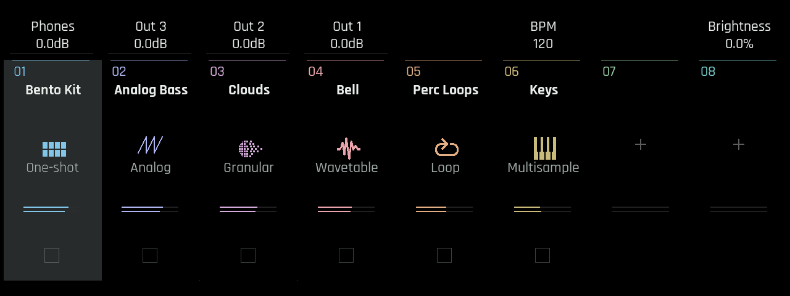

# Bento Playground

An unofficial community mod for the **1010music Bento**. The idea is to make more of Bento’s lovely hardware without losing the direct, hands-on feel that makes it enjoyable to use.

The current release is **Bento Playground Alpha 1.0**, built on stock **1.6.1** application firmware. It brings the additions below together in this first release, with source code, an offline patcher and an in-depth guide to how the controls fit together.

## What it adds

- Five drum synths and a virtual analogue workhorse synth with PWM and oscillator sync.
- Quick modulation setup directly on the synth page, inspired by Serum and Pigments.
- Editable Euclidean patterns, chord and progression tools, and an arpeggiator.
- Per-note parameter locks and trigger conditions.
- Record supported instrument knob movements into the clip’s existing automation lanes.
- Eight macros, each controlling up to three parameters.
- Per-track EQ, compression and clipping.
- Shortcuts to jump straight to a track’s instrument or sequencer.
- Hold MIXER or LAUNCH for quick mute/solo and clip control; release to return.
- Mute individual drum slots on track 1 with PLAY + pad during playback.
- A visual overhaul based on some obvious inspirations and my personal preferences.

[**Illustrated user guide**](docs/USER_GUIDE.md) — illustrated page explanations, controls, worked examples and limitations.

## Safety first

Quoted directly from a 1010music developer on Discord, regarding Blackbox modding. The same guidance was also given for Bento:

> As long as you're willing to take responsibility for it & people recognize it's at-your-own-risk, go for it. And a note for developers: don't overwrite the bootloader section of flash (if you're hacking you know what this means) — this ought to make it possible for people to reflash our existing production firmware through the usual channel.

**Never overwrite the bootloader.** Preserving it is essential to retaining the normal route for reinstalling official firmware. Modifying your device’s firmware is entirely at your own risk and may affect your warranty.

## Try Alpha 1.0

[**Download the offline patcher**](https://github.com/t4kbsv99sn-source/bento-playground/releases/tag/alpha-1.0) ·\
[Installation and restore](docs/QUICKSTART.md) ·\
[Known issues](docs/STATUS.md) ·\
[Build from source](docs/DEVELOPER_GUIDE.md)

The patcher requires your original **Bento 1.6.1 firmware pair** and runs locally. No manufacturer firmware is distributed, and nothing is flashed automatically.

This is a first alpha, not a finished replacement for the stock firmware. The features have been tested incrementally on hardware by one person—me—on one Bento. Don’t expect every possible interaction and situation to have been worked out. They haven’t. That said, on my device it’s already been a lot of very stable fun.

## Get involved

Ideas, musical experiments, bug reports, code reviews and workflow feedback are all welcome. Please describe as clearly as possible what you tried, what happened and which build you used.

I’d love for other developers to fork the project, take it in their own direction and share what they come up with. My preferences are just one possible starting point. It would be great to see a community grow around exploring what this hardware can do.

Feedback from more experienced programmers would be especially welcome. There’s likely room to improve the code, particularly its performance and efficiency, and I’d love help finding those opportunities.

See [CONTRIBUTING.md](CONTRIBUTING.md) and the [developer guide](docs/DEVELOPER_GUIDE.md) for a starting point.

## Related projects

Other projects exploring custom firmware and modifications for 1010music hardware:

- [romanjeff/bento_enhanced](https://github.com/romanjeff/bento_enhanced)
- [viktorakos95/blackbox-mod](https://github.com/viktorakos95/blackbox-mod)
- [pocketrave/blackbox](https://github.com/pocketrave/blackbox)
- [Blindsmyth/custom-blackbox-fw](https://github.com/Blindsmyth/custom-blackbox-fw)

## A note about the project

This thing runs on vibe and enthusiasm. I don’t have a programming background. The project was developed with AI coding assistants and tested incrementally on hardware.

It started with me wanting to add a few shortcuts. Then I kept going to see where I’d hit a serious wall. So far, I haven’t.

## License

Project additions are GPL-3.0-or-later; vendored code retains its respective licenses. See [LICENSE](LICENSE) and [third-party notices](THIRD_PARTY_NOTICES.md).
