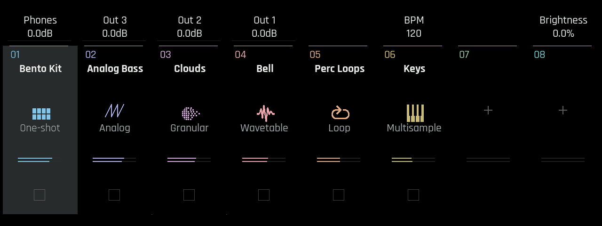

# Bento Playground

An unofficial community mod for the **1010music Bento**. The idea is to make more of Bento’s lovely hardware without losing the direct, hands-on feel that makes it enjoyable to use.

**Bento Playground** now runs on official **1.6.8** application firmware. This repository holds its current source and an in-depth guide to how the controls fit together. It’s still in development: there’s no ready-made download at the moment.

## What it adds

- Six drum synths and a virtual analogue workhorse synth with PWM and oscillator sync.
- Quick modulation setup directly on the synth page, inspired by Serum and Pigments.
- Editable Euclidean patterns for drums and melodies.
- Per-note parameter locks, ratchets and trigger conditions.
- Record supported instrument knob movements into the clip’s existing automation lanes.
- A Perform page with chord mode, an arpeggiator and a live display of the notes and chords you play.
- Eight macros, each controlling up to three parameters with their own ranges.
- Per-track EQ, compression and saturation.
- Choose which tracks go through the XY performance effects.
- Every page button cycles through its views, and shortcuts jump straight to a track’s instrument or sequencer.
- Hold MIXER or LAUNCH for quick mute/solo and clip control; release to return.
- Mute individual drum slots on track 1 with PLAY + pad during playback.
- A visual overhaul based on some obvious inspirations and my personal preferences.

[**Illustrated user guide**](docs/USER_GUIDE.md) — page explanations, controls, worked examples and limitations.

## Get involved

I’d love for other developers to fork the project, take it in their own direction and share what they come up with. My preferences are just one possible starting point. It would be great to see a community grow around exploring what this hardware can do.

Feedback from more experienced programmers would be especially welcome. There’s likely room to improve the code, particularly its performance and efficiency, and I’d love help finding those opportunities.

See [CONTRIBUTING.md](CONTRIBUTING.md) and the [developer guide](docs/DEVELOPER_GUIDE.md) for a starting point. The [porting notes and hook finder](https://github.com/hunting-ghosts/bento-community-lab/tree/main/research/porting) show how Playground moved from 1.6.1 to 1.6.8.

## Related projects

Other projects exploring custom firmware and modifications for 1010music hardware:

- [romanjeff/bento_enhanced](https://github.com/romanjeff/bento_enhanced): thanks to romanjeff, whose work was a helpful reference for the trigger conditions and the crash log (no code was taken).
- [viktorakos95/blackbox-mod](https://github.com/viktorakos95/blackbox-mod)
- [pocketrave/blackbox](https://github.com/pocketrave/blackbox)
- [Blindsmyth/custom-blackbox-fw](https://github.com/Blindsmyth/custom-blackbox-fw)

## License

Project additions are GPL-3.0-or-later; vendored code retains its respective licenses. See [LICENSE](LICENSE) and [third-party notices](THIRD_PARTY_NOTICES.md).
