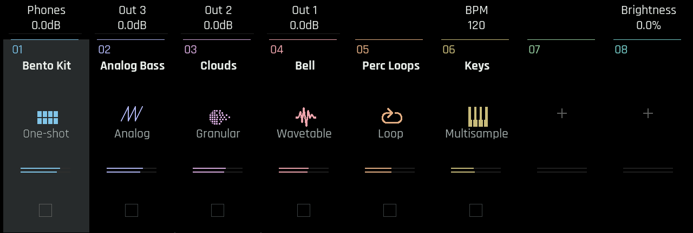
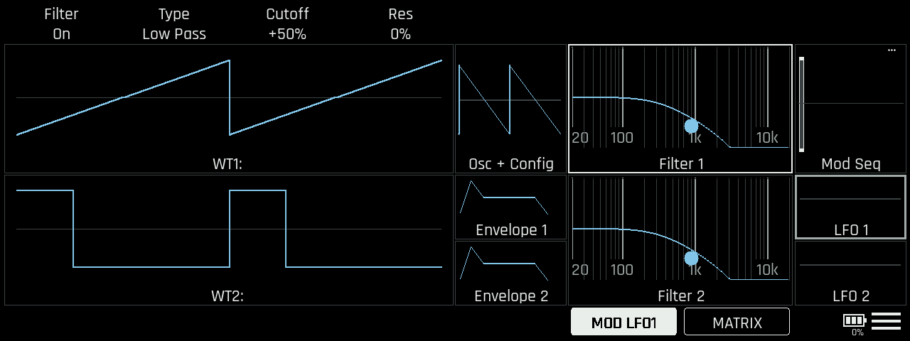
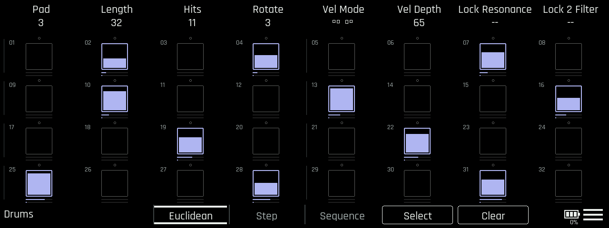
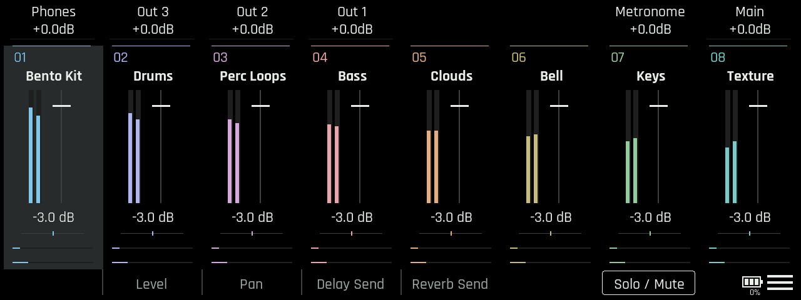
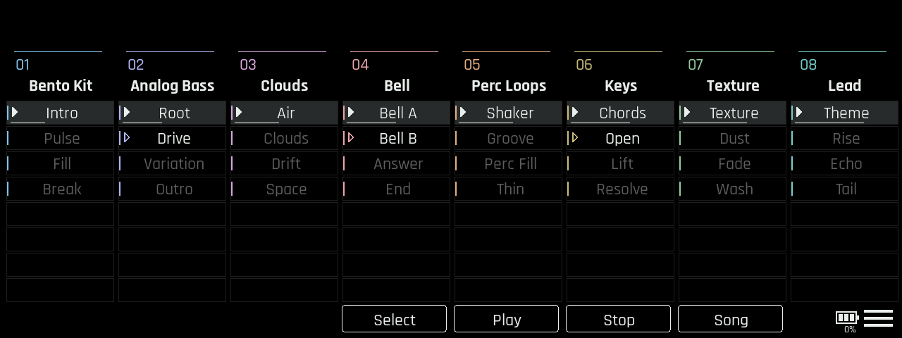
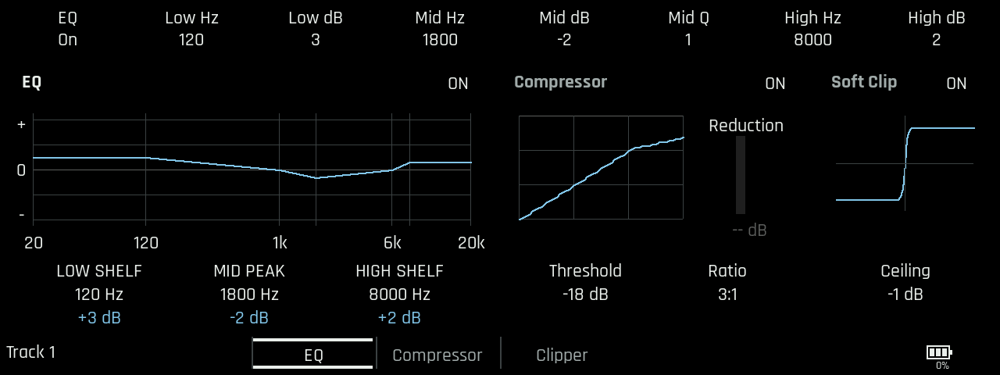
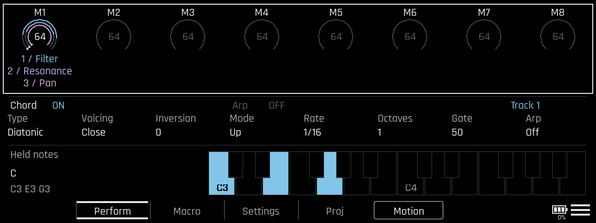
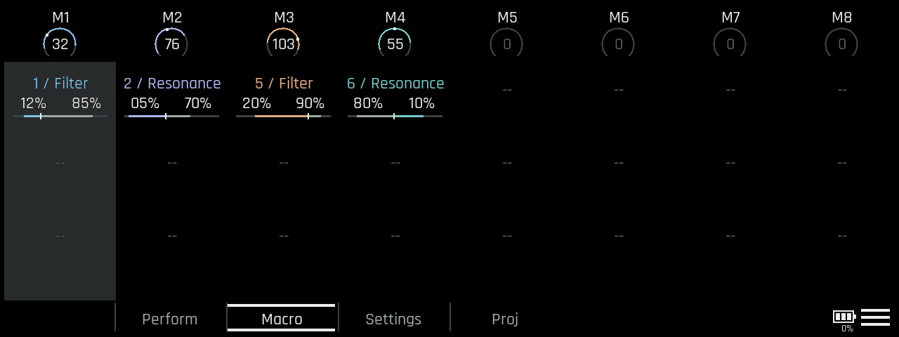

# User Guide

This guide covers **Bento Playground Alpha 1.0**, based on Bento 1.6.1.
It supplements the manufacturer's manual rather than replacing it.

For patching, installation and recovery,
use [Quickstart](QUICKSTART.md).

## Contents

- [Navigation and shortcuts](#navigation-and-shortcuts)
- [Movement and modulation](#movement-and-modulation)
- [Tracks](#tracks)
- [Instruments and drum synths](#instruments-and-drum-synths)
- [Drum sequencer](#drum-sequencer)
- [Euclidean patterns](#euclidean-patterns)
- [Melodic sequencing, chords and Arp](#melodic-sequencing-chords-and-arp)
- [Mixer, Launch and live mutes](#mixer-launch-and-live-mutes)
- [Track effects](#track-effects)
- [Perform and macros](#perform-and-macros)
- [Motion recording](#motion-recording)
- [Performance](#performance)

### About the illustrations

The screen images in this guide are firmware UI renders, not device photographs.
Track names, values, meters, mappings and notes are examples.

## Navigation and shortcuts

Pads are numbered **1-8 across the top row** and **9-16 across the bottom row**,
left to right. Encoder numbers E1-E8 run left to right above the display.

| Action | Result |
|---|---|
| TRACKS | Track overview |
| Hold TRACKS + top-row pad | Open that track's instrument |
| Hold TRACKS + bottom-row pad | Open that track's sequencer |
| Double-tap TRACKS | Selected track's Track FX |
| Hold MIXER | Temporary Mixer performance access; top-row pad: solo; bottom-row pad: mute; release to return |
| PROJ | Perform, with Macro, per Track Chord and Arp Settings |
| Hold PLAY alone while already playing + pad | Toggle one-shot slot mute on track 1 |

## Movement and modulation

Playground brings several ways to add movement together. Each has its own purpose:

| Method | What it does | Where it fits |
|---|---|---|
| [Parameter locks](#two-parameter-locks-per-note) | Set sound parameters for individual notes. | Precise changes from one note or hit to the next. |
| [Motion recording](#motion-recording) | Record encoder movements into clip automation. | Capture a hands-on gesture and have the clip repeat it. |
| [MOD mapping](#mod-quick-modulation) | Assign envelopes, LFOs or Mod Seq to sound parameters. | Shape each note or keep a sound moving without recording knob movements. |

Macros complement these with hands-on control of several parameters at once.
The aim is to make these approaches easy to use together.

## Tracks

*Tracks overview with six example instruments and two empty columns.
The lower squares are sequencer shortcuts; this render is cropped above
the screen footer.*

Each column belongs to one track. Its colour helps identify the same track
on the sequencer, Mixer and other pages.

| Touch area | Action |
|---|---|
| Track name/header | Mute/unmute without changing the selected track |
| Column body | Select that track |
| Instrument symbol | Double-tap to select and open INST |
| Lower sequencer square | Double-tap to select and open SEQ |

Selection and mute are separate. A muted track is still available for editing.
If you want to jump directly from another page, use TRACKS plus a pad instead
of first selecting a column.

## Instruments and drum synths

Native one-shot, multisample, loop, wavetable, granular and external-track
workflows remain available. Playground adds these programmable drum engines:

| Engine | Main sound-shaping controls |
|---|---|
| Kick | Tune, Decay, Tone, Impact, Sweep, Sweep Decay, Punch, Click |
| Snare | Tune, Decay, Tone, Impact, Snappy |
| Hi-hat | Tune, Decay, Tone, Impact, Noise |
| Clap | Tune, Decay, Tone, Impact, Spread |
| Tom / FM percussion | Tune, Decay, Tone, Impact, Sweep, Sweep Decay, Dirt |

The patcher's six small WAV files are **silent engine selectors**, not sampled
drums. Load a drum selector into a one-shot slot through the normal sample
workflow; its marker activates the corresponding synth. The instrument
workflow also provides drum-engine selection. Edit the synth's encoder
controls on its instrument page, then sequence the slot as a normal drum pad.
Keep the selector files available when moving projects.

Drum synths have native Mod Matrix destinations for their own controls as
well as standard parameters. Use the matrix for explicit modulation routing.

### Analog synth

**Analog** is a virtual analogue workhorse synth built on Bento’s existing
wavetable synth design. It uses the same familiar filters, envelopes and
modulation, with **pulse-width modulation (PWM)** and **oscillator sync**.

### MOD: quick modulation

*Analog MOD render with example settings: saw and pulse oscillator shapes,
LFO 1 selected as the modulation source, and cutoff depth at +50%.*

On the synth instrument page, the **MOD** button in the footer lets you assign
modulation directly instead of going through the Mod Matrix.

1. Select the section you want to modulate, such as a filter.
2. Tap **MOD**, then tap a source tile: **Envelope 1/2, LFO 1/2 or Mod Seq**. Selected sources have an orange outline; tap again to deselect.
3. Turn a supported parameter's encoder to set the modulation depth, from **−100% to +100%**. In this mode, the encoder changes modulation depth rather than the parameter's base value.
4. Tap **MOD** again to return to normal sound editing. The modulation stays assigned.

For example, select a filter, enable MOD, tap **LFO 1** and turn **Cutoff** to add filter movement.

You can select several sources at once; encoder turns set the same depth for each selected source, subject to the three-route limit per destination. Set a route's depth to zero to remove it.

**MATRIX** opens the native modulation matrix to inspect or edit the routes. Switching tracks turns MOD mode off. Outside MOD mode, parameter readouts show source tags such as **E1/E2** (envelopes), **L1/L2** (LFOs), **S** (Mod Seq) and **A–D** (automation).

## Drum sequencer

*One-shot sequencer with Euclidean selected: Pad, Length, Hits, Rotate,
velocity and lock controls above a 32-step pattern. Filled cells represent
notes, fill height represents velocity, and the small rails show lock values.
The encoder controls change with the selected view and note.*

Select a one-shot track, open SEQ and choose the pad to edit. The **Step** view
shows that pad's steps; **Sequence** provides the native sequence-level view.
The **Euclidean** tab exposes the generator. Each view retains its own encoder
bank rather than assigning the same meaning to every encoder everywhere.

### Enter and inspect notes

Tap a step to toggle a trigger. To inspect an existing hit **without deleting
it**, hold it. Enable **Select** to choose several steps without toggling their
notes; edits then apply to the selected steps. Turn Select off to return to
normal step entry.

Velocity changes the strength of a hit. Offset moves it relative to the grid.
Probability and repeating conditions introduce variation. A condition such as
**1:2** means one occurrence every two cycles; it is not a velocity value.

### Two parameter locks per note

E7 and E8 edit the two lock slots:

1. Select the step or steps.
2. Tap a lock's encoder readout to switch between its target picker and value.
3. Choose a destination, then set the locked value.
4. Double-tap that lock control to remove **only that slot** from the selection.

E6 provides Lock-Conditions.

A lock applies a parameter value to a note; it is not a continuous automation
curve. The target picker is instrument-specific.

Locks, native modulation and A-D automation can affect the same sound. For
initial testing, use one of them at a time so the source of a change is clear.

## Euclidean patterns

Euclidean sequencing distributes a number of hits across a cycle. For example,
**5 hits over 16 steps** gives a repeating five-hit rhythm; Rotation moves its
starting position without changing the hit count.

On a one-shot track, open **Euclidean** and choose the drum pad. Set its
length, hit count and rotation, then choose velocity mode/depth for accents
or other velocity shapes. E7/E8 remain locks. Use the displayed labels:
the normal Step controls and Euclidean controls are different banks.

- Pad cycles can have different lengths and keep their own playback phases.
- Generated patterns use **real native notes**. You can add, remove and edit
  their hits rather than treating the generator as an uneditable audio effect.
- Changing generation settings regenerates the pattern. Make a project copy
  before replacing a hand-edited variation.

Copy/Move/Double/Undo combinations are not fully reliable for Euclidean
metadata. In particular, Double Seq has a report of missing generated notes.
Do not treat clip duplication as a safe substitute for a saved project backup.
The generator can create Undo operations, but that is not complete Undo
coverage for every associated setting.

## Melodic sequencing, chords and Arp

On a pitched track, the sequencer footer is:

**Chord / Euclid / Step/Seq / Automation / Select / Clear**

Tap **Step/Seq** repeatedly to switch Step and Sequence. Double-tap physical
**SEQ** for the same cycle; from Chord, Euclid or Automation it returns to Step.
**Use the Chord tab to open Chord**, not SEQ double-tap.
Automation opens the native A-D editor; tapping it again returns to Step.

Melodic Euclid has **four independent rows**, each with its own pitch, length,
hit count and rotation. The rows can run with different cycle lengths.
Generated notes can be edited in the piano roll; row lengths do not change
the clip length.

### Chord entry

Use **Chord** on a pitched track to play full chords from the keyboard pads
and edit chord material in the piano roll. Choose Type, Voicing and Inversion;
Diatonic and Diatonic 7 follow the project's root and scale. The editor also provides Rhythm, position and length controls.
Left/Right moves between chords; touching an existing chord's notes selects it.

### Arpeggiator

In **Perform**, select the **Chord & Arp** strip. Arp has:

| Control | Choices / meaning |
|---|---|
| Arp | Off, On, Latch |
| Mode | Up, Down, Up/Down, As Played, Random |
| Rate | 1/4 through 1/32, with triplet choices |
| Octaves | 1-4 |
| Gate | 10-100% note duration relative to each Arp step |

Enable On, hold notes on the selected pitched track and adjust Rate/Mode.
Latch retains the note set after pad release; turn Arp Off to end the mode.
Arp settings are per track.

## Mixer, Launch and live mutes

*Mixer with the output controls above eight track strips. Below each fader
are Pan, Delay Send and Reverb Send rails; the footer selects the encoder
bank. Meter levels and track names are examples. The project compressor is
accessed through the burger menu, separately from the Track FX compressor.*

### Mixer

Each column controls a track's Level, Pan, Delay Send and Reverb Send.
Choose a footer mode to give the eight encoders that parameter across tracks.
Touch drags adjust Level vertically and Pan/sends horizontally, with relative
pickup so the first touch should not jump to a new value.
Tap a track's name to mute without selecting another track.

Hold **MIXER** for temporary access. Its pad performance layout gives top-row
Solo and bottom-row Mute across the eight tracks. Release to return to the
previous page; the mix changes remain.

Meters reflect the signal after the channel strip and fader, not just the
unprocessed instrument.

### Launch

*Launcher with example clips and playback states.*

Hold **LAUNCH** for clip performance: the top row stops and the bottom row
starts each track's selected clip. Release to return.
This gesture is not a command to stop every clip in the project.

The Launch screen also has **Select / Play / Stop** actions for grouped clip
control. Selection is temporary and limited to one selected clip per track.
Grouped actions retain native launch quantization; Stop is track-wide.

### PLAY-held one-shot mute bank

With playback **already running**, hold **PLAY alone**:

1. The pads address the 16 slots of **track 1**, regardless of the current
   page or selected track.
2. Populated, unmuted slots light in track 1's colour; muted/empty slots are dark.
3. Tap a pad to toggle its slot mute, without triggering its note.
4. Release PLAY to restore normal pad lights. The mutes stay latched.

Track 1 must be one-shot; the gesture does not silently target another track.
These are **slot mutes**, unlike the whole-track mutes on Tracks/Mixer.
Normal PLAY from stopped and ordinary pad playing retain their native behaviour.

## Track effects

*Track FX overview with example EQ, compressor and soft-clip settings.*

Select a track and **double-tap TRACKS** to open its channel strip.
The **EQ / Compressor / Clipper** footer and graph regions select the
corresponding encoder bank.

- **EQ** shapes the combined track signal.
- **Compressor** controls dynamics; Auto Makeup is an estimated compensation,
  not guaranteed perceived-loudness matching.
- **Soft Clipper** rounds peaks. It is not a master true-peak safety limiter.

This processing is per track, not per drum pad.
The gain-reduction readout remains unfinished (`-- dB`).

## Perform and macros

*Perform overview with three targets mapped to M1, Chord and Arp controls,
and a held C major chord shown on the keyboard. Motion is available in the footer.*

Press **PROJ** to open Perform.
The macro group controls M1-M8; the combined Chord & Arp group controls the
selected pitched track. **Settings** holds Global settings, Date/Time and the
selected track's Pads settings. **Proj** retains native project browsing,
Save and Load.

### Map one macro

There are eight project macros, each with **up to three targets**.

1. In Perform or the Macro overview, **tap a macro to arm mapping**.
2. Navigate to a parameter's encoder readout and **tap the readout** to bind
   it. Turning the encoder alone does not create a mapping.
3. Add up to three supported targets. A mapped parameter is marked `=`.
4. Tap the armed macro again, tap the mapping readout, or press **PROJ**
   to leave mapping mode.
5. Return to Perform and turn that macro's encoder.

Macro targets are encoder-backed controls, not arbitrary touchscreen objects.
They can span different tracks and supported drum slots.

**Deletion is different from disarming:** double-tapping a macro clears
**all its mappings**. Double-tapping a mapped parameter removes that binding;
double-tapping a target row on the Macro page removes just that row.
Do not double-tap a macro merely to stop mapping.

### Edit ranges

*Macro view with M1 selected. Example targets show their tracks,
Min/Max values and range bars; the other macros are unassigned.*

On **Macro**, touch a body column to select its detailed controls. Touch the
header to return to macro amounts; Up/Down also switches overview/detail.
In overview, E1-E8 control M1-M8 amounts. In detail:

| Encoders | Function |
|---|---|
| E1 / E2 | Target 1 minimum / maximum |
| E3 / E4 | Target 2 minimum / maximum |
| E5 / E6 | Target 3 minimum / maximum |
| E7 | Sensitivity |
| E8 | Selected macro amount |

Targets remain displayed in their macro columns. Reversed Min/Max ranges
move a target in the opposite direction. Macro turns move targets relatively
from their current native values; a target edited elsewhere is read again
instead of assuming the previous macro position still owns its value.

**Example:** map one macro to a synth Filter Cutoff and its Reverb Send.
Give Cutoff a useful middle range and Reverb a restrained range, then test
the macro at both ends. Save the project and check the mapping after reload.
Macros are direct control, not automatic Motion recording.

## Motion recording

Motion records supported **instrument encoder movements** into the playing
clip's native A-D automation. It is separate from step locks, audio recording
and macro mapping. Physical RECORD is unchanged and is not required for capture.

1. Select a finite clip of **1-256 steps** and start that clip playing.
2. Enable **Motion** in the PROJ/Perform footer.
3. Return to the instrument page and turn a supported encoder.
4. Check for **writing**. The persistent **MOTION ON** indicator can also
   be tapped to disable capture.
5. Turn Motion off, listen to playback and inspect **Automation**.

### Supported controls

| Instrument section | Motion-enabled encoders |
|---|---|
| Wavetable 1/2 | Level, Position |
| Native oscillator | Level, Pulse Width |
| Synth filters 1/2 | Cutoff, Resonance |
| Synth envelopes 1/2 | Attack, Decay, Release |
| Synth LFOs 1/2 | Rate, Depth |
| Granular 1/2 | Level, Density, Grain Size, Window, Jitter, Play Pos |
| Sampler slots | Attack, Decay, Release, Resonance, LFO Rate, LFO Depth |

**Not supported:** Pitch, Sustain, mixer/dB
volume, granular Speed/Live Pos, custom drum knobs, FX, macros, Arp and
private Sync/Glide controls. Sampler Filter is not the synth Cutoff destination.

### Lanes, routes and capture limits

There are **four native A-D lanes**, tied to clip length, not an independent
unlimited motion loop. Only moved steps are written; untouched steps are
not filled or interpolated.

An unassigned destination gets the first genuinely unused lane/modulation slot.
Existing nonzero routes retain their lane and depth. Other clips' saved points
and existing routes can reserve lanes. Shared, disabled or ambiguous routes
are not silently replaced to make recording work.

Track, clip, length or project changes disarm capture. A stopped selected
clip or another playing row blocks capture.

| Readout | What to do |
|---|---|
| writing | Capture occurred; disable Motion to audition without writing |
| No free A-D | Free a lane/slot deliberately, or use another clip/project |
| Check route | Inspect the existing modulation assignment |
| Motion range | The encoder scale or resulting lane value is unsupported |
| Not a motion target | Use a supported control from the table |
| Motion memory | Native allocation/write failed; do not assume a take exists |

A refused turn may not edit the parameter while armed. **Turn Motion off
before normal editing** after a refusal.
Recording Motion adds CPU load. Once you turn Motion off, the recorded movements
play back through the normal automation lanes.

## Performance

On my own Bento, Alpha 1.0 has been a lot of fun and runs well enough for decent,
stable sessions. It is also easy to overdo it and max out the CPU, as it already
was with the stock firmware. Depending on the project, audio artefacts can appear
sooner than I’d like.

I want to reduce the added features’ CPU load in future updates. For now, it
helps to keep the music focused and work within the hardware’s limits:

- Keep polyphony and unison to what the part actually needs.
- Use drum synths, dense parameter locks and multiple Euclidean rows selectively.
- Keep granular density and grain size moderate when the rest of the project is busy.
- Disable processing you don’t need.
- Turn Motion off once you’ve recorded the movements you want.
- Resample a demanding part when you want to free resources for something else.

If a project starts struggling, reduce overlapping voices first, then look at
granular settings and effects. There isn’t one setting that fits every project.
