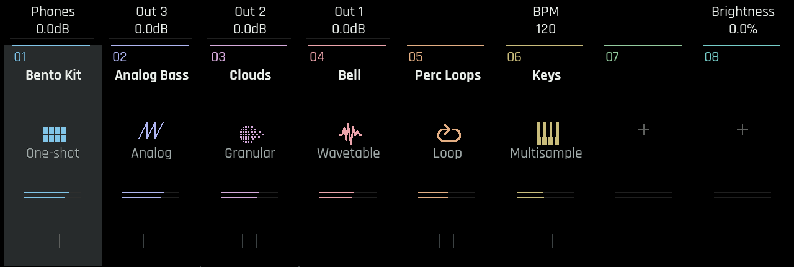
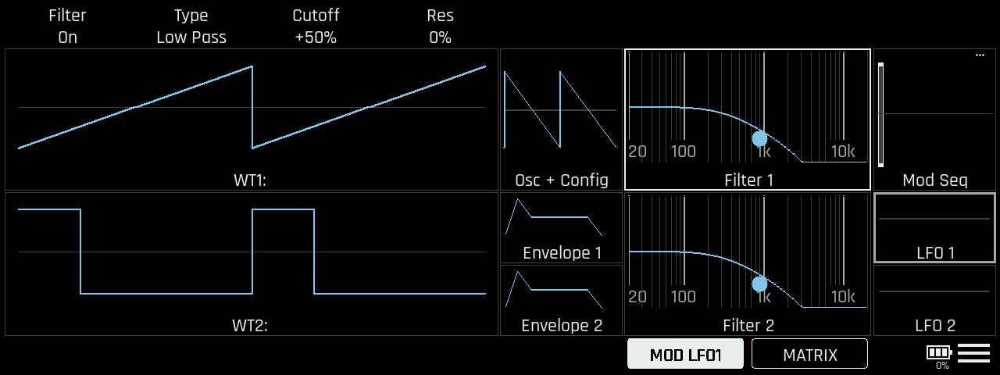
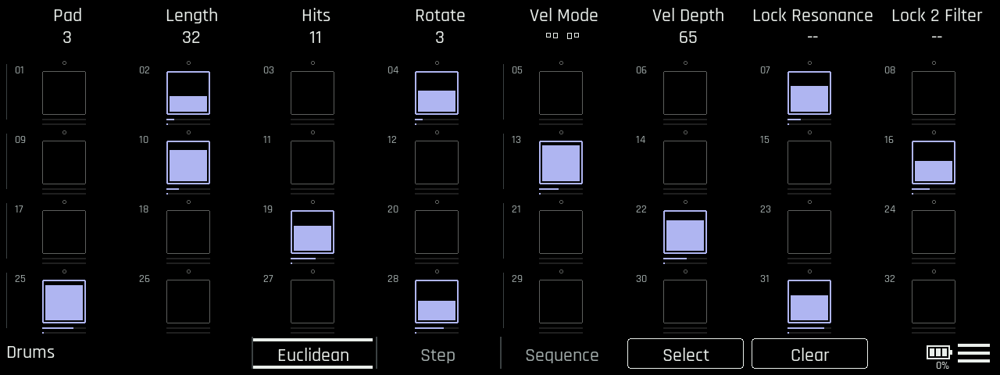
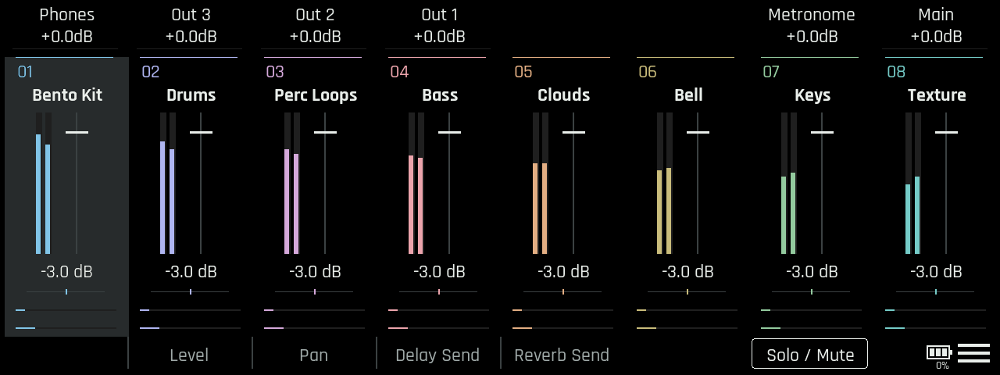
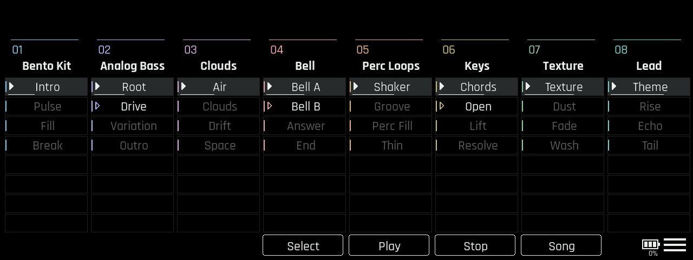
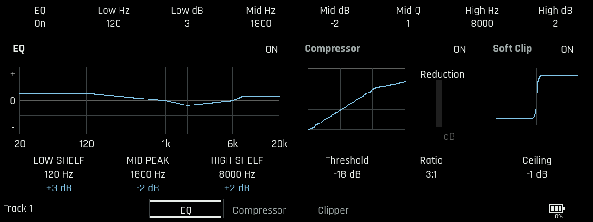
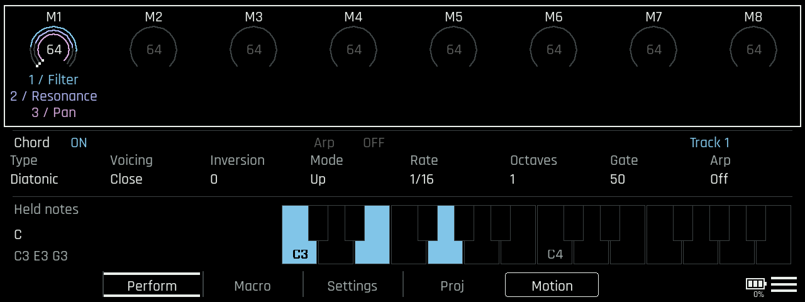
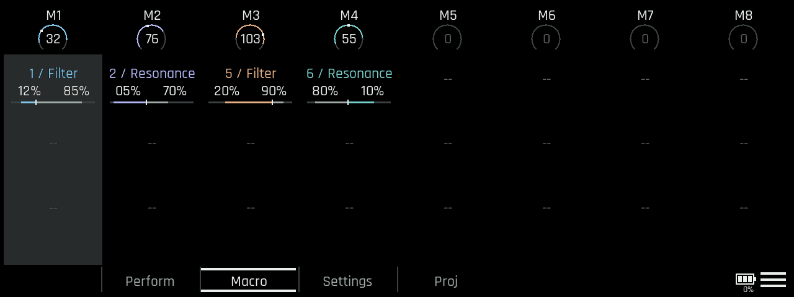

# User Guide

This guide covers **Bento Playground** on Bento 1.6.8, as in the current
source (the build shown in Settings as **P168 exp8b**).
It supplements the manufacturer's manual rather than replacing it.
Alpha 1.0 (on 1.6.1) works the same way except where a section says
**New since Alpha 1.0**.

For installation and recovery, see [Quickstart](QUICKSTART.md).

## Contents

- [Navigation and shortcuts](#navigation-and-shortcuts)
- [Movement and modulation](#movement-and-modulation)
- [Tracks](#tracks)
- [Instruments and drum synths](#instruments-and-drum-synths)
- [Drum sequencer](#drum-sequencer)
- [Ratchets](#ratchets)
- [Trigger conditions](#trigger-conditions)
- [Euclidean patterns](#euclidean-patterns)
- [Melodic sequencing, chords and Arp](#melodic-sequencing-chords-and-arp)
- [Mixer, Launch and live mutes](#mixer-launch-and-live-mutes)
- [Track effects](#track-effects)
- [XY effects per track](#xy-effects-per-track)
- [FX pages](#fx-pages)
- [Perform, macros, Settings and Projects](#perform-macros-settings-and-projects)
- [Motion recording](#motion-recording)
- [Performance](#performance)
- [Crash log](#crash-log)

### About the illustrations

The screen images in this guide are firmware UI renders, not device photographs.
Track names, values, meters, mappings and notes are examples.
Most images still show Alpha 1.0 screens; several pages look different on
the current build (Perform, Track FX, Mixer, the FX pages).

## Navigation and shortcuts

Pads are numbered **1-8 across the top row** and **9-16 across the bottom row**,
left to right. Encoder numbers E1-E8 run left to right above the display.

| Action | Result |
|---|---|
| TRACKS | Track overview |
| TRACKS, repeatedly | Tracks ↔ the selected track's Track FX |
| Hold TRACKS + top-row pad | Open that track's instrument |
| Hold TRACKS + bottom-row pad | Open that track's sequencer |
| SEQ, repeatedly | Cycle the sequencer views (one-shot: Euclid, Steps, Seq, Auto; pitched: Steps, Seq, Auto, Euclid) |
| INST, repeatedly | Cycle the instrument's views (one-shot kit: Kit, Pad); each track remembers its last one |
| FX, repeatedly | Mod FX, Send FX, XY Pads |
| MIXER, repeatedly | Level, Track, Pan, Delay, Reverb |
| Hold MIXER | Temporary Mixer performance access; top-row pad: solo; bottom-row pad: mute; release to return to the screen you were on |
| PROJ, repeatedly | Perform, Macro, Settings, Projects |
| Double-tap PROJ | Projects |
| Left + Right together (one-shot track) | Switch the pads between Pads (choose a sound) and Steps (16 steps of that sound) |
| Hold PLAY alone while already playing + pad | Toggle one-shot slot mute on track 1 |

**New since Alpha 1.0:** every page button now cycles through all of its views,
and the footer shows the same views in the same order with the current one
lit. Actions such as Undo, Copy and Clear live in the burger menu.
On pages with several rows of controls (Settings, Perform, Mixer, Send FX),
Up/Down or a tap picks the row; a thin frame marks it.

The old double-tap on TRACKS is gone; press TRACKS a second time instead.

## Movement and modulation

Playground brings several ways to add movement together. Each has its own purpose:

| Method | What it does | Where it fits |
|---|---|---|
| [Parameter locks](#two-parameter-locks-per-note) | Set sound parameters for individual notes. | Precise changes from one note or hit to the next. |
| [Motion recording](#motion-recording) | Record encoder movements into clip automation. | Capture a hands-on gesture and have the clip repeat it. |
| [MOD mapping](#mod-quick-modulation) | Assign envelopes, LFOs or Mod Seq to sound parameters. | Shape each note or keep a sound moving without recording knob movements. |

Macros complement these with hands-on control of several parameters at once.
The aim is to make these approaches easy to use together.

## Tracks

*Tracks overview with six example instruments and two empty columns.
This Alpha 1.0 render is cropped above the screen footer; on the current
build the lower squares are the XY toggles.*

Each column belongs to one track. Its colour helps identify the same track
on the sequencer, Mixer and other pages.

| Touch area | Action |
|---|---|
| Track name/header | Mute/unmute without changing the selected track |
| Column body | Select that track |
| Instrument symbol | Double-tap to select and open INST |
| Lower square | Tap: this track goes through the XY effects or not (see [XY effects per track](#xy-effects-per-track)) |
| Footer **Track FX** | Open the selected track's Track FX |

Selection and mute are separate. A muted track is still available for editing.
If you want to jump directly from another page, use TRACKS plus a pad instead
of first selecting a column.

## Instruments and drum synths

Native one-shot, multisample, loop, wavetable, granular and external-track
workflows remain available. Playground adds these programmable drum engines:

| Engine | Main sound-shaping controls |
|---|---|
| Kick | Tune, Decay, Tone, Impact, Sweep, Sweep Decay, Punch, Click |
| Snare | Tune, Decay, Tone, Impact, Snappy |
| Hi-hat | Tune, Decay, Tone, Impact, Noise |
| Clap | Tune, Decay, Tone, Impact, Spread |
| Tom / FM percussion | Tune, Decay, Tone, Impact, Sweep, Sweep Decay, Dirt |
| Metal (**new since Alpha 1.0**) | Tune, Decay, Width, Sweep Speed, Sweep Range, LFO Speed, LFO Depth |

On its first start, Bento Playground creates a `Drum Synths` folder on the SD card
with small WAV files. They are **silent engine selectors**, not sampled drums.
Load a drum selector into a one-shot slot through the normal sample
workflow; its marker activates the corresponding synth. On a drum synth's
instrument page, the engine buttons switch the slot between the six engines.
Edit the synth's encoder controls on its instrument page, then sequence the
slot as a normal drum pad. Keep the selector files available when moving
projects.

Drum synth pads and Analog tracks now keep their sound after saving and
loading a project (in Alpha 1.0 they could come back silent).
Old projects with a Syncussion pad or track load and play it as Metal.

Drum synths have native Mod Matrix destinations for their own controls as
well as standard parameters. Use the matrix for explicit modulation routing.

### Analog synth

**Analog** is a virtual analogue workhorse synth built on Bento’s existing
wavetable synth design. It uses the same familiar filters, envelopes and
modulation, with **pulse-width modulation (PWM)** and **oscillator sync**.

### MOD: quick modulation

*Analog MOD render with example settings: saw and pulse oscillator shapes,
LFO 1 selected as the modulation source, and cutoff depth at +50%.*

On the synth instrument page, the **MOD** button in the footer lets you assign
modulation directly instead of going through the Mod Matrix.

1. Select the section you want to modulate, such as a filter.
2. Tap **MOD**, then tap a source tile: **Envelope 1/2, LFO 1/2 or Mod Seq**. Selected sources have an orange outline; tap again to deselect.
3. Turn a supported parameter's encoder to set the modulation depth, from **−100% to +100%**. In this mode, the encoder changes modulation depth rather than the parameter's base value.
4. Tap **MOD** again to return to normal sound editing. The modulation stays assigned.

For example, select a filter, enable MOD, tap **LFO 1** and turn **Cutoff** to add filter movement.

You can select several sources at once; encoder turns set the same depth for each selected source, subject to the three-route limit per destination. Set a route's depth to zero to remove it.

**MATRIX** opens the native modulation matrix to inspect or edit the routes. Switching tracks turns MOD mode off. Outside MOD mode, parameter readouts show source tags such as **E1/E2** (envelopes), **L1/L2** (LFOs), **S** (Mod Seq) and **A–D** (automation).

## Drum sequencer

*One-shot sequencer with Euclidean selected: Pad, Length, Hits, Rotate,
velocity and lock controls above a 32-step pattern. Filled cells represent
notes, fill height represents velocity, and the small rails show lock values.
The encoder controls change with the selected view and note.*

Select a one-shot track, open SEQ and choose the pad to edit. Press SEQ again
to cycle **Euclid → Steps → Seq → Auto**; the footer shows the same views.
A pad opens on **Steps**, which shows that pad's steps; **Seq** provides the
native sequence-level view; **Euclid** exposes the generator; **Auto** is the
native A-D automation editor. Each view retains its own encoder bank rather
than assigning the same meaning to every encoder everywhere.

Press **Left + Right together** to switch the pads between **Pads** (a pad
press quietly selects that sound) and **Steps** (the pads show 16 steps of the
selected sound; tap to add or remove, hold to open the step; Left/Right page
by 16). The choice is kept per track.

### Enter and inspect notes

Tap a step to toggle a trigger. To inspect an existing hit **without deleting
it**, hold it. Enable **Select** to choose several steps without toggling their
notes; edits then apply to the selected steps. Turn Select off to return to
normal step entry.

Velocity changes the strength of a hit. Offset moves it relative to the grid.
Probability and repeating conditions introduce variation. A condition such as
**1:2** means one occurrence every two cycles; it is not a velocity value.
See [Trigger conditions](#trigger-conditions) for the full list.

### Two parameter locks per note

E7 and E8 edit the two lock slots:

1. Select the step or steps.
2. Tap a lock's encoder readout to switch between its target picker and value.
3. Choose a destination, then set the locked value.
4. Double-tap that lock control to remove **only that slot** from the selection.

E6 (**Locks when**) sets a condition for the locks: the note plays as usual,
and its locks apply only when the condition is met.

A lock applies a parameter value to a note; it is not a continuous automation
curve. The target picker is instrument-specific.

Locks, native modulation and A-D automation can affect the same sound. For
initial testing, use one of them at a time so the source of a change is clear.

## Ratchets

**New since Alpha 1.0.** A ratchet repeats a note several times inside its own
length: 3 hits on a 1/16 step are three even hits within that 1/16. Ratchets
work on drum steps and on notes of pitched tracks.

1. Hold a step (or select steps) in **Steps**, or select a note in the piano
   roll (**Seq** view or its Event tab).
2. Press **Right** on its own. Encoders E5-E8 switch to **Count / Shape /
   Depth / Prob**. Press **Left** to get the locks back. The page you used last
   is remembered for the next held step.
3. Set **Count** (2-8 hits). Count 1 removes the ratchet.
4. Choose a **Shape**: Flat (every hit the same), Fade (getting softer) or
   Swell (getting louder). **Depth** sets how strong the fade or swell is;
   choosing a shape starts it at 60.
5. **Prob** decides whether the ratchet happens. If the note plays but the
   ratchet doesn't, you hear a single hit. Prob takes the same choices as the
   other [trigger conditions](#trigger-conditions).

Edits apply to all held or selected notes and can be undone in one step.
Steps with a ratchet show one small tick per hit.

**Ratchet amount:** on **Perform**, the Chord & Arp strip has a per-track
Ratchet amount from 0 to 100 %. At 0 % every ratchet plays as a single hit;
it scales ratchets with a % probability, while A:B ratchets keep their
pattern. It is saved with the project and can be a macro target.

Each new hit cuts off the previous one of the same note on sample-based
sounds (drums, one-shots, multisamples). On synth engines such as Wavetable
and Granular, the previous hit still fades out with its normal release.

## Trigger conditions

A trigger condition decides on each pass whether something happens. The same
list is available in four places:

- the note's own condition (held-step or note editor),
- **Locks when**, for its parameter locks,
- a ratchet's **Prob**,
- the lock condition of pitched-track notes.

| Choice | Meaning |
|---|---|
| 1-99 % | Plays with that chance each pass |
| Always | Plays every pass |
| A:B (1:2 to 4:4) | Plays on pass A of every B passes, e.g. 2:4 on the second of every four |
| 1ST | Plays only on the first pass after the clip starts or restarts |
| !1ST | Plays on every pass except the first |
| PRE | Plays only if the most recent A:B, 1ST or !1ST decision in the same sequence played |
| !PRE | Plays only if that decision did not play |

**New since Alpha 1.0:** 1ST, !1ST, PRE and !PRE, and the shorter A:B list (up
to 4:4) so they are quick to reach. PRE is off until an earlier A:B, 1ST or
!1ST condition in the sequence has been decided; % and other PRE steps don't
count as that decision.

Projects with A:B values above 4:4 from earlier builds still load and play
them as before. They are shown, but you can't pick them again once changed.

On the official firmware, notes with 1ST/!1ST/PRE/!PRE play on every pass
and show a wrong condition name, as A:B conditions always have.

## Euclidean patterns

Euclidean sequencing distributes a number of hits across a cycle. For example,
**5 hits over 16 steps** gives a repeating five-hit rhythm; Rotation moves its
starting position without changing the hit count.

On a one-shot track, open **Euclidean** and choose the drum pad. Set its
length, hit count and rotation, then choose velocity mode/depth for accents
or other velocity shapes. E7/E8 remain locks. Use the displayed labels:
the normal Step controls and Euclidean controls are different banks.

- Pad cycles can have different lengths and keep their own playback phases.
- Generated patterns use **real native notes**. You can add, remove and edit
  their hits rather than treating the generator as an uneditable audio effect.
- Changing generation settings regenerates the pattern. Make a project copy
  before replacing a hand-edited variation.

Copy/Move/Double/Undo combinations are not fully reliable for Euclidean
metadata. In particular, Double Seq has a report of missing generated notes.
Do not treat clip duplication as a safe substitute for a saved project backup.
The generator can create Undo operations, but that is not complete Undo
coverage for every associated setting.

## Melodic sequencing, chords and Arp

On a pitched track, the sequencer footer is:

**Steps / Seq / Auto / Euclid / Select**

Press physical **SEQ** repeatedly to cycle the views in that order, or tap
one in the footer. Each track remembers its last view. **Auto** opens the
native A-D editor. Clear, Undo and the other actions are in the burger menu.

**Transpose** (**new since Alpha 1.0**): in the **Seq** view, encoders E7/E8 set
up a live transposition of the track's sequence from the pads, relative to
the project's root and scale; it stays on per track until you change it.

Melodic Euclid has **four independent rows**, each with its own pitch, length,
hit count and rotation. The rows can run with different cycle lengths.
Generated notes can be edited in the piano roll; row lengths do not change
the clip length.

### Chords

The piano-roll chord editor (chord progressions) is **switched off** in the
current build to make room in the full firmware; its code is kept and may come
back. Chords written with it in older projects are ordinary notes and keep
playing. To play chords live, use chord mode on [Perform](#perform-macros-settings-and-projects).

### Arpeggiator

On **Perform**, pick the **Arp** row (Up/Down or tap). Arp has:

| Control | Choices / meaning |
|---|---|
| Arp | Off, On, Latch |
| Mode | Up, Down, Up/Down, As Played, Random |
| Rate | 1/4 through 1/32, with triplet choices |
| Octaves | 1-4 |
| Gate | 10-100% note duration relative to each Arp step |

Enable On, hold notes on the selected pitched track and adjust Rate/Mode.
Latch retains the note set after pad release; turn Arp Off to end the mode.
Arp settings are per track.

## Mixer, Launch and live mutes

*Mixer with the output controls above eight track strips. Below each fader
are Pan, Delay Send and Reverb Send rails; the footer selects the encoder
bank. Meter levels and track names are examples. The project compressor is
accessed through the burger menu, separately from the Track FX compressor.*

### Mixer

Each column controls a track's Level, Pan, Delay Send and Reverb Send.
Choose a footer mode to give the eight encoders that parameter across tracks,
or press MIXER repeatedly to cycle **Level → Track → Pan → Delay → Reverb**.
**Track** keeps the Mixer on screen and gives the header encoders the
selected track's Level, Pan, Delay and Reverb.
Touch drags adjust Level vertically and Pan/sends horizontally, with relative
pickup so the first touch should not jump to a new value.
Tap a track's name to mute without selecting another track.

Hold **MIXER** for temporary access. Its pad performance layout gives top-row
Solo and bottom-row Mute across the eight tracks. Release to return to the
previous page; the mix changes remain.

Up arrow gives the encoders the top row (Phones, Out 1-3, Metronome, Main);
Down arrow returns them to the track strips. Left/Right select the previous or
next track.

Meters reflect the signal after the channel strip and fader, not just the
unprocessed instrument.

### Launch

*Launcher with example clips and playback states.*

Hold **LAUNCH** for clip performance: the top row stops and the bottom row
starts each track's selected clip. Release to return.
This gesture is not a command to stop every clip in the project.

On 1.6.8 the Launch pads use 1010music's own lighting. A white outline on
screen marks the two clip rows the pads currently launch.

The Launch screen also has **Select / Play / Stop** actions for grouped clip
control. Selection is temporary and limited to one selected clip per track.
Grouped actions retain native launch quantization; Stop is track-wide.

### PLAY-held one-shot mute bank

With playback **already running**, hold **PLAY alone**:

1. The pads address the 16 slots of **track 1**, regardless of the current
   page or selected track.
2. Populated, unmuted slots light in track 1's colour; muted/empty slots are dark.
3. Tap a pad to toggle its slot mute, without triggering its note.
4. Release PLAY to restore normal pad lights. The mutes stay latched.

Track 1 must be one-shot; the gesture does not silently target another track.
These are **slot mutes**, unlike the whole-track mutes on Tracks/Mixer.
Normal PLAY from stopped and ordinary pad playing retain their native behaviour.

## Track effects

*Track FX overview with example EQ, compressor and soft-clip settings.*

Select a track on Tracks and **press TRACKS again** (or tap **Track FX** in
the footer) to open its channel strip. Left/Right, or a tap on a block, picks
**EQ / Compressor / Saturator**; the graphs are drawn in the track colour.

- **EQ** shapes the combined track signal.
- **Compressor** controls dynamics; Auto Makeup is an estimated compensation,
  not guaranteed perceived-loudness matching.
- **Saturator** (the former clipper): On/Off, Mode **Soft** (default) or
  **Hard**, **Drive** (pushes the signal into the curve; the level is
  compensated automatically) and an output **Level**. Old projects with the
  clipper load with the same sound. It is not a master true-peak safety limiter.

This processing is per track, not per drum pad.
The gain-reduction readout remains unfinished (`-- dB`).

**New since Alpha 1.0:** EQ gain moves in **0.5 dB** steps (shown with one
decimal, e.g. `+1.5 dB`) and Mid Q in **0.05** steps (e.g. `1.25`). All
Track FX encoders move evenly; frequency follows a musical (logarithmic)
scale. Projects from Alpha 1.0 load with their values. Projects saved with
Bento Playground on 1.6.8 store gain and Q in finer units, so Alpha 1.0 would read them far
too large.

## XY effects per track

By default, as on the official firmware, every track goes through the XY
performance effects. Tap a track's **lower square** on Tracks to take that
track out: it is then mixed in after the XY effects and stays untouched by
them. Tap again to put it back. On the XY page, encoder 4 **Returns thru XY**
decides whether the delay and reverb returns go through the XY effects.
Both settings are saved with the project; older builds and the official
firmware ignore them (everything goes through the XY effects there).

## FX pages

Press **FX** repeatedly to cycle **Mod FX → Send FX → XY Pads**; the footer
shows the same three.

- **Mod FX:** Left/Right choose Chorus, Phaser or Flanger+Dist. The picture
  follows Amount, Rate, Feedback and Distortion. The eight squares at the
  bottom, under the track names, switch a track's output to *Output 1 w/ Mod
  FX* (tap = on/off).
- **Send FX:** the Delay row on top, the Reverb row below; the pictures (rings
  for the delay, a tail per reverb style) change with every knob.

## Perform, macros, Settings and Projects

*Perform as it looked in Alpha 1.0. The current Perform page no longer
shows the macro knobs (they are on the Macro page); see the description below.*

Press **PROJ** to open Perform. Each further press moves on:
**Perform → Macro → Settings → Projects → Perform**. A quick double press
jumps straight to Projects. All four views share one footer, with
**Perform | Macro | Settings | Projects** always in the same place and the
current one lit; tap one to switch. The free footer slots next to them hold
that view's actions: Motion (Perform, Macro), Set Time and Motion (Settings),
Save and Load (Projects).

**Perform** shows the eight track names on top in their colours; the
selected one is bold with a bar under it. Tap a name to select that track,
or use Left/Right. On the left is the project key, the chord you play (large,
in the track colour) and its notes; after you let go of the pads the name
stays, dimmer. On the right a two-octave keyboard lights the keys you hold.

There are two rows of controls: the **Chord** row (Chord, Type, Voicing,
Inversion, Velocity, Fixed Vel) and the **Arp** row (Arp, Mode, Rate, Octaves,
Gate, [Ratchet](#ratchets), Swing, BPM). Swing and BPM change the project's
swing and tempo. The footer adds **Tap** (tap in time to set the tempo) and
**Motion**.

**Macro** holds the eight project macros M1-M8. **Settings** holds Global
settings, Date/Time and the selected track's Pads settings, and shows the
installed firmware name. **Projects** is the native project browser with Save
and Load.

### Map one macro

There are eight project macros, each with **up to three targets**.

1. In Perform or the Macro overview, **tap a macro to arm mapping**.
2. Navigate to a parameter's encoder readout and **tap the readout** to bind
   it. Turning the encoder alone does not create a mapping.
3. Add up to three supported targets. A mapped parameter is marked `=`.
4. Tap the armed macro again, tap the mapping readout, or press **PROJ**
   to leave mapping mode.
5. Return to Perform and turn that macro's encoder.

Macro targets are encoder-backed controls, not arbitrary touchscreen objects.
They can span different tracks and supported drum slots.

**Deletion is different from disarming:** double-tapping a macro clears
**all its mappings**. Double-tapping a mapped parameter removes that binding;
double-tapping a target row on the Macro page removes just that row.
Do not double-tap a macro merely to stop mapping.

### Edit ranges

*Macro view with M1 selected. Example targets show their tracks,
Min/Max values and range bars; the other macros are unassigned.*

On **Macro**, touch a body column to select its detailed controls. Touch the
header to return to macro amounts; Up/Down also switches overview/detail.
In overview, E1-E8 control M1-M8 amounts. In detail:

| Encoders | Function |
|---|---|
| E1 / E2 | Target 1 minimum / maximum |
| E3 / E4 | Target 2 minimum / maximum |
| E5 / E6 | Target 3 minimum / maximum |
| E7 | Sensitivity |
| E8 | Selected macro amount |

Targets remain displayed in their macro columns. Reversed Min/Max ranges
move a target in the opposite direction. Macro turns move targets relatively
from their current native values; a target edited elsewhere is read again
instead of assuming the previous macro position still owns its value.

**Example:** map one macro to a synth Filter Cutoff and its Reverb Send.
Give Cutoff a useful middle range and Reverb a restrained range, then test
the macro at both ends. Save the project and check the mapping after reload.
Macros are direct control, not automatic Motion recording.

## Motion recording

Motion records supported **instrument encoder movements** into the playing
clip's native A-D automation. It is separate from step locks, audio recording
and macro mapping. Physical RECORD is unchanged and is not required for capture.

1. Select a finite clip of **1-256 steps** and start that clip playing.
2. Enable **Motion** in the PROJ/Perform footer.
3. Return to the instrument page and turn a supported encoder.
4. Check for **writing**. The persistent **MOTION ON** indicator can also
   be tapped to disable capture.
5. Turn Motion off, listen to playback and inspect **Automation**.

### Supported controls

| Instrument section | Motion-enabled encoders |
|---|---|
| Wavetable 1/2 | Level, Position |
| Native oscillator | Level, Pulse Width |
| Synth filters 1/2 | Cutoff, Resonance |
| Synth envelopes 1/2 | Attack, Decay, Release |
| Synth LFOs 1/2 | Rate, Depth |
| Granular 1/2 | Level, Density, Grain Size, Window, Jitter, Play Pos |
| Sampler slots | Attack, Decay, Release, Resonance, LFO Rate, LFO Depth |

**Not supported:** Pitch, Sustain, mixer/dB
volume, granular Speed/Live Pos, custom drum knobs, FX, macros, Arp and
private Sync/Glide controls. Sampler Filter is not the synth Cutoff destination.

### Lanes, routes and capture limits

There are **four native A-D lanes**, tied to clip length, not an independent
unlimited motion loop. Only moved steps are written; untouched steps are
not filled or interpolated.

An unassigned destination gets the first genuinely unused lane/modulation slot.
Existing nonzero routes retain their lane and depth. Other clips' saved points
and existing routes can reserve lanes. Shared, disabled or ambiguous routes
are not silently replaced to make recording work.

Track, clip, length or project changes disarm capture. A stopped selected
clip or another playing row blocks capture.

| Readout | What to do |
|---|---|
| writing | Capture occurred; disable Motion to audition without writing |
| No free A-D | Free a lane/slot deliberately, or use another clip/project |
| Check route | Inspect the existing modulation assignment |
| Motion range | The encoder scale or resulting lane value is unsupported |
| Not a motion target | Use a supported control from the table |
| Motion memory | Native allocation/write failed; do not assume a take exists |

A refused turn may not edit the parameter while armed. **Turn Motion off
before normal editing** after a refusal.
Recording Motion adds CPU load. Once you turn Motion off, the recorded movements
play back through the normal automation lanes.

## Performance

On my own Bento, Playground has been a lot of fun and runs well enough for decent,
stable sessions. It is also easy to overdo it and max out the CPU, as it already
was with the stock firmware. Depending on the project, audio artefacts can appear
sooner than I’d like.

I want to reduce the added features’ CPU load in future updates. For now, it
helps to keep the music focused and work within the hardware’s limits:

- Keep polyphony and unison to what the part actually needs.
- Use drum synths, dense parameter locks and multiple Euclidean rows selectively.
- Keep granular density and grain size moderate when the rest of the project is busy.
- Disable processing you don’t need.
- Turn Motion off once you’ve recorded the movements you want.
- Resample a demanding part when you want to free resources for something else.

If a project starts struggling, reduce overlapping voices first, then look at
granular settings and effects. There isn’t one setting that fits every project.

Ratchets add notes, so dense ratchets on several tracks add load too.

## Crash log

**New since Alpha 1.0.** The Bento keeps a short log file, `BENTO_CRASHES.log`,
in the root of the SD card. It gets one line each time the Bento starts
(with the firmware name) and one line for each crash the firmware recorded.
It only writes right after the Bento's own saving or loading of a project,
never while music is playing, and it gives up quietly if the card is missing
or full.

If something goes wrong, please attach this file to your
[bug report](https://github.com/hunting-ghosts/bento-playground/issues/new?template=bug_report.md).
It contains only technical numbers: no project names, samples or personal
data. You can delete it at any time; a new one is started.
